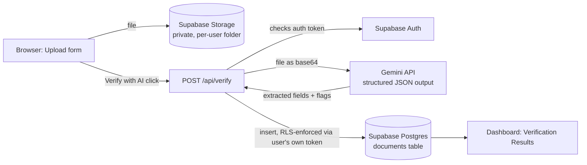

# VerifyLite

A small prototype of an AI-powered document verification tool — built to learn the stack used by an early-stage startup's identity/education/employment verification product before interviewing for a software engineering internship there.

**Only fake test documents are used** (made-up résumés and diplomas, including one with deliberate inconsistencies) — this handles the same category of sensitive data (identity/education records) their real product does, so it's treated the same way: no real personal data goes anywhere near it.

## What it does

1. A user signs up / logs in (Supabase Auth)
2. They upload a résumé or diploma (PDF/image) to a private, per-user folder (Supabase Storage)
3. They click "Verify with AI" — the file is sent to a server route that calls an AI model to extract structured fields (name, school, degree, employer, dates) and flag inconsistencies (e.g. graduation before enrollment, overlapping employment dates)
4. Results are saved to Postgres and shown on the dashboard
5. *(in progress)* Semantic search across documents in plain English, using vector embeddings

## Data flow



Every step after upload runs through one server-side route (`app/api/verify/route.js`) — the browser never holds the AI API key, and the database insert uses the *requesting user's own* auth token (not a service-role key), so Postgres Row Level Security enforces "you can only see your own documents" automatically rather than relying on application code to remember to check.

## Why these choices

- **Gemini instead of OpenAI** — same category of multimodal LLM API the job posting lists (OpenAI), swapped to a free tier to keep this at $0. The AI call is isolated in one function, so switching providers back is a small, contained change.
- **Multimodal LLM instead of OCR + computer vision** — Gemini reads the PDF/image directly and returns structured JSON in one call, instead of a separate OCR step followed by a separate parsing step. True computer vision (face matching, ID tamper detection) is a different technique this project doesn't implement.
- **Row Level Security** — access control enforced at the database level, not just in application code, since this is the kind of sensitive data (identity/education records) where that matters.
- **Structured JSON output (response schema)**, not free-text parsing — reduces (doesn't eliminate) the risk of the AI returning something the app can't handle; the route still validates/handles a failed or malformed response.

## Tech stack

| Layer | Tool |
|---|---|
| Frontend | Next.js (App Router), React, Tailwind CSS |
| Auth | Supabase Auth |
| File storage | Supabase Storage (private bucket, RLS policies) |
| Database | Supabase Postgres (JSONB columns, Row Level Security) |
| API | Next.js Route Handlers (REST) |
| AI | Google Gemini (multimodal extraction, structured JSON output) |
| Hosting (planned) | Vercel |

## Status

- [x] Auth (sign up / log in)
- [x] Upload to private per-user Storage folder
- [x] AI extraction + red-flag detection (`/api/verify`)
- [x] Save results to Postgres with RLS
- [ ] Semantic search (pgvector + embeddings)
- [ ] Stripe test-mode checkout + webhook (stretch)
- [ ] Deployed to Vercel

## Running locally

```bash
npm install
npm run dev
```

Requires a `.env.local` with `NEXT_PUBLIC_SUPABASE_URL`, `NEXT_PUBLIC_SUPABASE_ANON_KEY`, and `GEMINI_API_KEY` (never committed — see `.gitignore`). Run `supabase_setup.sql` once in the Supabase SQL Editor to create the storage bucket, policies, and `documents` table before first use.

## What's next

- Semantic search over extracted documents
- Stripe test-mode "Pro" upgrade + webhook
- A mobile client (scoped out of this prototype to focus on the verification pipeline itself)
